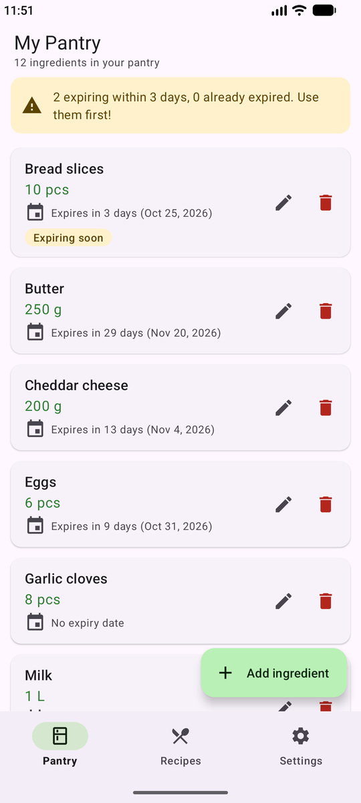
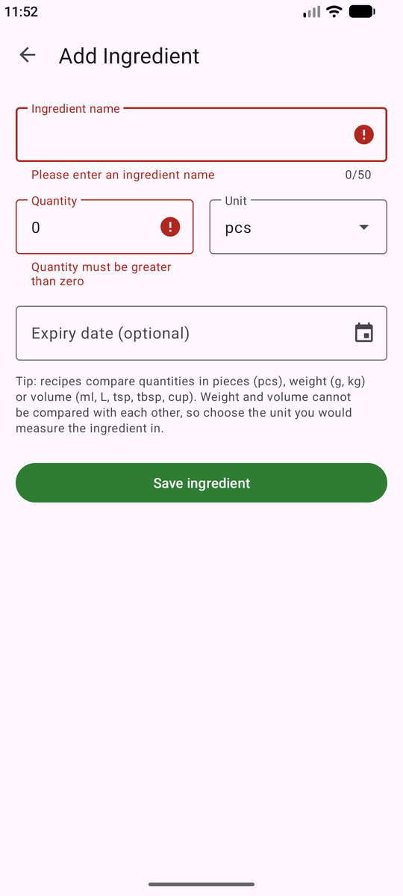
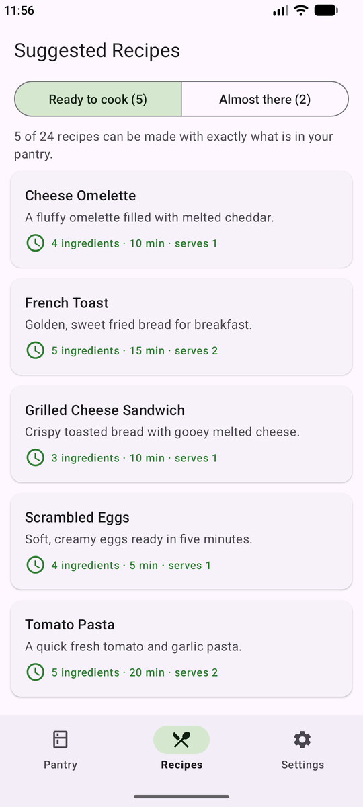
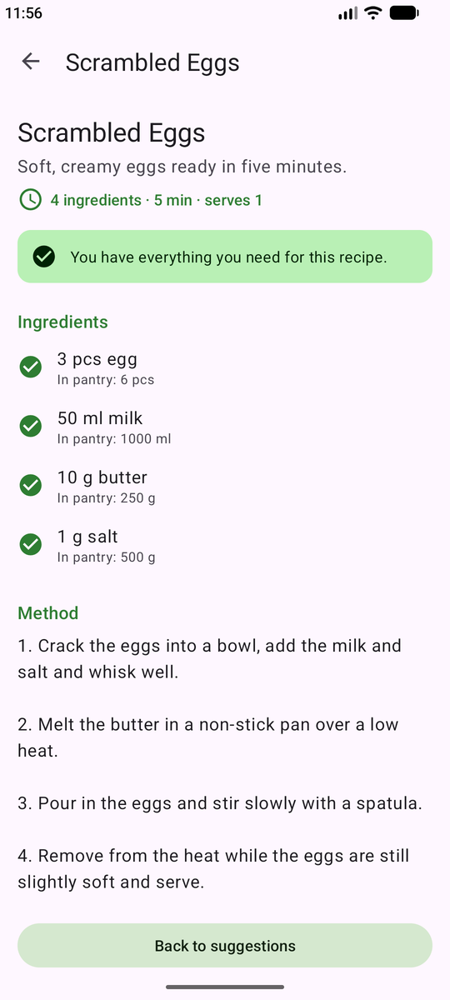
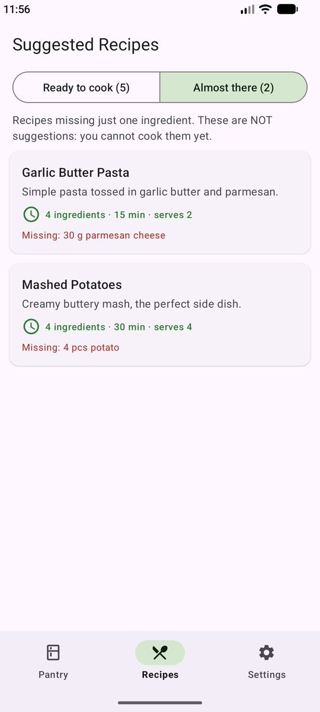
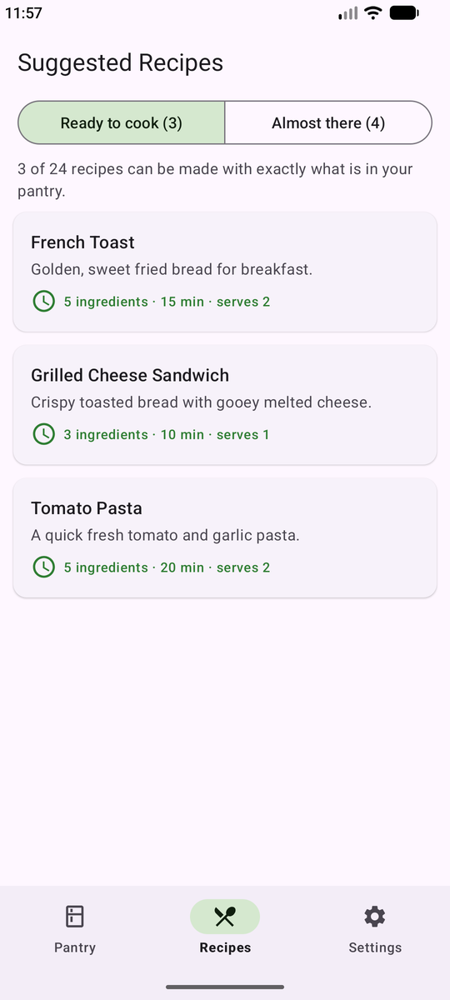
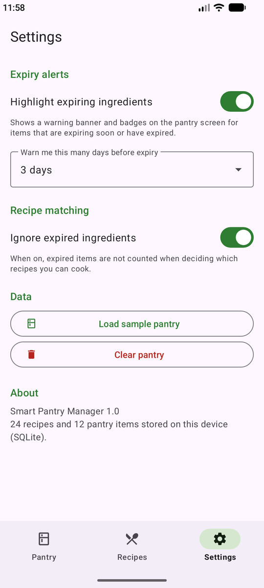
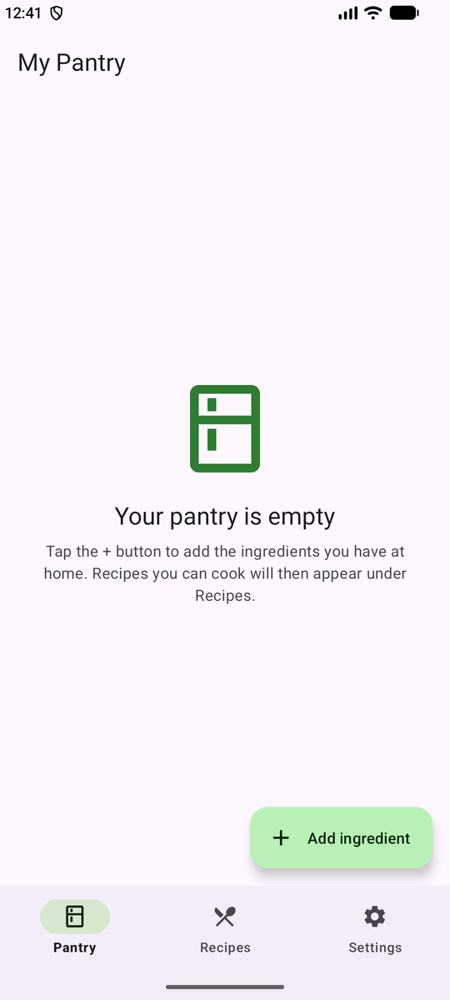

# Smart Pantry Manager

[](https://github.com/iri26subi/SmartPantryManager/actions/workflows/android-ci.yml)

A Java Android app that helps reduce food waste. You record the ingredients you
already have at home (your "pantry"), and the app suggests recipes you can cook
**using only those ingredients**. A recipe is suggested only if *every*
ingredient it needs is in your pantry in at least the required quantity.

Built for Mobile App Development 700 (practical assignment) by **Irfaan Subrathee** (student number 402311943).
Repository: https://github.com/iri26subi/SmartPantryManager

## Features

| Screen | What it does |
|---|---|
| **Pantry** (launcher) | RecyclerView list of pantry items (name, quantity, unit, optional expiry date) loaded from SQLite. Add (button), edit (tap a card or the pencil), delete (bin icon, with confirmation). Empty-state message. "Expiring soon" / "Expired" badges and a warning banner. |
| **Add / Edit Ingredient** | One form for both modes. Validates the name (required, ≤ 50 characters, letters/digits/spaces/hyphens/apostrophes) and the quantity (required, a number, > 0, ≤ 100 000). Unit picked from a dropdown, optional expiry date from a date picker. Saves to SQLite and returns to the pantry, which refreshes. |
| **Suggested Recipes** | Runs the strict matcher against the current pantry. "Ready to cook" lists only full matches. A separate "Almost there" tab (optional stretch) lists recipes missing exactly one ingredient and says what is missing. Re-runs in `onResume()`, so it always reflects the latest pantry. Shows a clear message when nothing matches. |
| **Recipe Detail** | Recipe name, description, time and servings, every ingredient with its quantity and a tick or cross showing whether your pantry covers it, numbered method steps, and a back button. |
| **Settings** | Expiry alerts on/off, the "expiring soon" window (1–7 days), whether expired items count for matching, load a sample pantry, clear the pantry. Saved with SharedPreferences. |

A bottom navigation bar moves between Pantry, Recipes and Settings. Every
screen change uses an explicit `Intent`; item and recipe ids are passed as
Intent extras.

The app uses no maps, location or internet permissions.

## Screenshots

Captured from the app running on an Android emulator. More are in [`docs/screenshots`](docs/screenshots).

| Pantry | Add (validation) | Suggested recipes | Recipe detail |
|---|---|---|---|
|  |  |  |  |
| **Almost there** | **Strict rule: eggs 6 → 2** | **Settings** | **Empty pantry** |
|  |  |  |  |

## Database choice: SQLite (SQLiteOpenHelper)

**Why SQLite:** the data belongs to one user on one device, so a local database
is the simplest fit. It works offline, needs no account, server or network
setup, and it is the persistence approach covered in the module's persistent
data chapter. `SQLiteOpenHelper` was chosen over Room to keep the SQL visible
and the dependency list short.

### Schema

```
pantry_items                         recipes
------------                         -------
id          INTEGER PK               id            INTEGER PK
name        TEXT NOT NULL            name          TEXT NOT NULL UNIQUE
quantity    REAL NOT NULL (> 0)      description   TEXT
unit        TEXT NOT NULL            instructions  TEXT NOT NULL (one step per line)
expiry_date TEXT (yyyy-MM-dd, null)  prep_minutes  INTEGER
                                     servings      INTEGER
                                          | 1
                                          |
                                          | *
                                     recipe_ingredients
                                     ------------------
                                     id         INTEGER PK
                                     recipe_id  INTEGER FK -> recipes.id ON DELETE CASCADE
                                     name       TEXT NOT NULL
                                     quantity   REAL NOT NULL (> 0)
                                     unit       TEXT NOT NULL
```

- **24 starter recipes** are seeded in `DatabaseHelper.onCreate()`, which
  Android runs only when the database file is first created. Seeding is also
  guarded by a row-count check and the `UNIQUE` recipe name, so recipes are
  never duplicated.
- Foreign keys are switched on in `onConfigure()`.
- `onUpgrade()` rebuilds and re-seeds the recipe tables but keeps the user's pantry.
- All queries use `?` placeholders, never string-concatenated user input.

## The strict-matching algorithm

`app/src/main/java/com/smartpantry/manager/matching/RecipeMatcher.java` has no
Android code in it, so it can be unit-tested on its own.

1. **Normalise names** (`IngredientNormalizer`): lower-case, strip punctuation,
   singularise the last word (`Tomatoes` → `tomato`, `berries` → `berry`,
   `bay leaves` → `bay leaf`) and map a few true synonyms
   (`scallion` → `spring onion`). Names must then match **exactly**, so
   `butter` never matches `peanut butter` and `egg` never matches `egg white`.
2. **Convert units** (`UnitConverter`): every unit has a dimension: count
   (`pcs`), mass (`g`, `kg`) or volume (`ml`, `L`, `tsp` = 5 ml, `tbsp` = 15 ml,
   `cup` = 250 ml metric). Quantities are compared in base units. **Mass and
   volume are never converted into each other** (that would need the density
   of each ingredient), so such a recipe is excluded rather than wrongly suggested.
3. **Combine duplicates:** pantry rows with the same normalised name and a
   compatible unit are added together (e.g. two egg boxes with different
   expiry dates).
4. **Decide:** each recipe ingredient is `AVAILABLE`, `INSUFFICIENT`,
   `MISSING` or `INCOMPATIBLE_UNIT`. A recipe is suggested **only if every
   ingredient is `AVAILABLE`**. An optional setting ignores expired pantry items.

## Project structure

```
app/src/main/java/com/smartpantry/manager/
├── model/      PantryItem, Recipe, RecipeIngredient
├── matching/   RecipeMatcher, IngredientNormalizer, UnitConverter, MatchResult, IngredientCheck
├── data/       DatabaseHelper, PantryRepository, RecipeRepository, RecipeSeedData,
│               DemoPantryData, AppSettings
├── ui/         BaseActivity, MainActivity (pantry), AddEditIngredientActivity,
│               SuggestedRecipesActivity, RecipeDetailActivity, SettingsActivity
├── ui/adapter/ PantryAdapter, RecipeAdapter, IngredientCheckAdapter
└── util/       IngredientValidator, ExpiryUtils, QuantityFormatter
app/src/test/java/...   81 JVM unit tests (JUnit 4 + Robolectric)
```

## Requirements

- Android Studio (2026.2 or newer; this project uses Android Gradle Plugin 9.4.1 and Gradle 9.6.1)
- Android SDK Platform 36 (Android Studio installs it automatically if missing)
- A JDK 17+ (Android Studio's bundled JDK works)
- An emulator or a phone running **Android 8.0 (API 26) or newer**

## Setup and run

1. Clone the repository:
   ```bash
   git clone https://github.com/iri26subi/SmartPantryManager.git
   ```
2. In Android Studio choose **File → Open** and select the `SmartPantryManager` folder.
3. Wait for the Gradle sync to finish. If Studio asks to install SDK Platform 36, accept.
4. Start an emulator (**Device Manager → Create device**, e.g. Pixel 8, API 35 or 36)
   or connect a phone with USB debugging switched on.
5. Press **Run ▶** (configuration `app`).

To try the app quickly, open **Settings → Load sample pantry**. A few recipes
(e.g. Scrambled Eggs, Tomato Pasta) become available straight away, and Garlic
Butter Pasta appears under "Almost there" because it still needs parmesan.

### Command line

```bash
./gradlew assembleDebug        # build app/build/outputs/apk/debug/app-debug.apk
./gradlew testDebugUnitTest    # run the unit tests
./gradlew lintDebug            # Android Lint
```

On Windows use `gradlew.bat`. Gradle needs `JAVA_HOME` set to a JDK, for example
Android Studio's bundled one: `C:\Program Files\Android\Android Studio\jbr`.

## Tests

`./gradlew testDebugUnitTest` runs 81 tests (also run by GitHub Actions on every push):

- `RecipeMatcherTest`: the brief's examples (3 eggs vs 4 or 2, missing milk, 4 of 5
  ingredients), plurals, unrelated names, unit conversion, incompatible units,
  duplicate aggregation, expiry setting, the "Almost there" list.
- `IngredientNormalizerTest`, `UnitConverterTest`, `IngredientValidatorTest`, `ExpiryUtilsTest`, `QuantityFormatterTest`
- `RecipeSeedDataTest`: at least 20 complete recipes with supported units.
- `DatabaseTest` (Robolectric, real SQLite): seeding without duplicates, the full
  pantry CRUD cycle, data persisting after reopening, CHECK constraint, cascade
  delete, upgrade keeps the pantry, suggestions changing as the pantry changes.
- `ScreenFlowTest` (Robolectric): each screen inflates, the navigation Intents,
  form validation, saving and editing, empty states, settings persistence.
